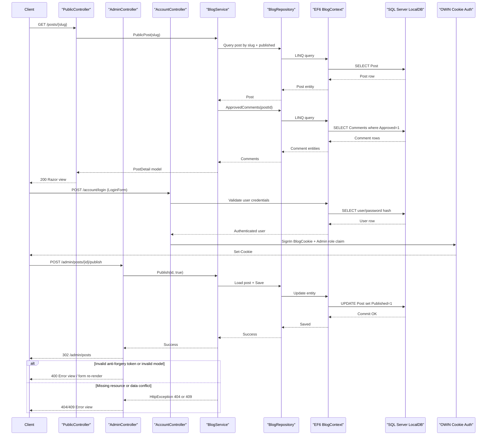

# API & Service Communication Contracts

The solution exposes an attribute-routed ASP.NET MVC surface with public browsing, comment submission, account authentication, and admin moderation/content-management endpoints. Communication is entirely synchronous inside a single deployable service (controller -> service -> repository -> EF/SQL), with no message bus or cross-service API hops.

## Service Catalog

| Service | Port | Category | Purpose |
|---|---|---|---|
| LegacyBlog (`LegacyBlog.csproj`) | `5080` in local run docs (IIS Express; configurable at launch) | Business | Single web app that serves public/admin HTTP endpoints, performs authentication, and persists blog data through EF6/Identity (`System.Web.Mvc`, `Microsoft.Owin.*`, `EntityFramework`). |

## API Endpoints Inventory

| Service | Method | Path | Request Type | Response Type |
|---|---|---|---|---|
| LegacyBlog/PublicController | GET | `/` | Query: `page` | Razor view with `PostList` (200; 400 for invalid page, 404 for page/category miss) |
| LegacyBlog/PublicController | GET | `/categories/{slug}` | Path: `slug`; Query: `page` | Razor view with `PostList` (200; 404 if category not found) |
| LegacyBlog/PublicController | GET | `/posts/{slug}` | Path: `slug` | Razor view with `PostDetail` + `CommentForm` (200; 404 if post missing/unpublished) |
| LegacyBlog/PublicController | POST | `/posts/{slug}/comments` | Path: `slug`; body/form DTO: `CommentForm` | Redirect to detail on success (302); validation failure re-renders `PostDetail` (400); 404 if post missing |
| LegacyBlog/PublicController | GET | `/error` | None | Razor error view (500) |
| LegacyBlog/AccountController | GET | `/account/login` | Query: `returnUrl` | Razor view with `LoginForm` (200) |
| LegacyBlog/AccountController | POST | `/account/login` | body/form DTO: `LoginForm` | Auth cookie sign-in + redirect (302); invalid credentials re-render form (200/400) |
| LegacyBlog/AccountController | POST | `/account/logout` | Anti-forgery form post | Cookie sign-out + redirect `/` (302) |
| LegacyBlog/AdminController | GET | `/admin` | Authenticated admin cookie | Razor dashboard view (200; 401/403 if unauthorized) |
| LegacyBlog/AdminController | GET | `/admin/posts` | Query: `page`; authenticated admin cookie | Razor view with `PostList` (200; 400/404 on invalid paging input) |
| LegacyBlog/AdminController | GET | `/admin/posts/create` | Authenticated admin cookie | Razor `PostForm` view (200) |
| LegacyBlog/AdminController | GET | `/admin/posts/{id}/edit` | Path: `id` via `RouteId` | Razor `PostForm` view (200; 404 if post not found) |
| LegacyBlog/AdminController | POST | `/admin/posts/create` | body/form DTO: `PostForm`; anti-forgery token | Save + redirect `/admin/posts` (302); validation issues re-render form (400); conflict 409 on slug/data conflicts |
| LegacyBlog/AdminController | POST | `/admin/posts/{id}/edit` | Path: `id`; body/form DTO: `PostForm`; anti-forgery token | Save + redirect `/admin/posts` (302); 404 if post missing; 409 on conflicts |
| LegacyBlog/AdminController | GET | `/admin/posts/{id}/delete` | Path: `id` | Razor confirmation view with `Post` (200; 404 if post missing) |
| LegacyBlog/AdminController | POST | `/admin/posts/{id}/delete` | Path: `id`; anti-forgery token | Delete + redirect `/admin/posts` (302; 404 if post missing) |
| LegacyBlog/AdminController | POST | `/admin/posts/{id}/publish` | Path: `id`; anti-forgery token | Toggle publish true + redirect (302; 404 if post missing) |
| LegacyBlog/AdminController | POST | `/admin/posts/{id}/unpublish` | Path: `id`; anti-forgery token | Toggle publish false + redirect (302; 404 if post missing) |
| LegacyBlog/AdminController | GET | `/admin/categories` | Authenticated admin cookie | Razor view with `Category` list (200) |
| LegacyBlog/AdminController | GET | `/admin/categories/create` | Authenticated admin cookie | Razor `CategoryForm` view (200) |
| LegacyBlog/AdminController | GET | `/admin/categories/{id}/edit` | Path: `id` via `RouteId` | Razor `CategoryForm` view (200; 404 if category missing) |
| LegacyBlog/AdminController | POST | `/admin/categories/create` | body/form DTO: `CategoryForm`; anti-forgery token | Save + redirect `/admin/categories` (302); validation issues re-render form (400); 409 on slug conflicts |
| LegacyBlog/AdminController | POST | `/admin/categories/{id}/edit` | Path: `id`; body/form DTO: `CategoryForm`; anti-forgery token | Save + redirect `/admin/categories` (302); 404 if missing; 409 on conflicts |
| LegacyBlog/AdminController | POST | `/admin/categories/{id}/delete` | Path: `id`; anti-forgery token | Delete + redirect `/admin/categories` (302); category-in-use path re-renders categories view; 409 conflict path enforced in service |
| LegacyBlog/AdminController | GET | `/admin/comments` | Authenticated admin cookie | Razor view of pending `Comment` list (200) |
| LegacyBlog/AdminController | POST | `/admin/comments/{id}/approve` | Path: `id`; anti-forgery token | Moderate + redirect `/admin/comments` (302; 404 if missing) |
| LegacyBlog/AdminController | POST | `/admin/comments/{id}/delete` | Path: `id`; anti-forgery token | Moderate/delete + redirect `/admin/comments` (302; 404 if missing) |

Versioning scheme: none detected (no URL/header/query API versioning pattern).

## Management & Observability Endpoints

| Service | Endpoint | Custom Metrics (if any) |
|---|---|---|
| LegacyBlog | None detected (`/health`, `/healthz`, `/swagger`, `/actuator*` not present) | None detected (`@Timed`, meter registration, or exporter endpoints not present) |

## DTOs & Contracts

The project uses MVC form/view contracts rather than JSON API DTOs. Request DTOs are `PostForm`, `CategoryForm`, `CommentForm`, and `LoginForm` (form-bound request bodies), with `RouteIdAttribute` as an explicit path `id` binder contract for admin edit/delete actions. Response/view contracts are `PostList` and `PostDetail`, while domain entity classes (`Post`, `Category`, `Comment`, `BlogUser`, `SeedState`) are passed to views or used internally by services/repositories (for entity details, see `data-architecture.md`).

No gateway-level aggregation DTOs were found because there is no API gateway or multi-service composition boundary. DTOs/entities are mutable C# classes (no C# records/immutable types found). OpenAPI/Swagger specs and annotations are not present, and no GraphQL or protobuf schemas were found. Serialization is standard ASP.NET MVC model binding with Razor view rendering; no custom JSON serializer pipeline was identified.

## Communication Patterns

Communication is synchronous and in-process: controllers call `BlogService`, which calls `BlogRepository`, which uses EF6/Identity over SQL Server LocalDB. No asynchronous messaging (Kafka, RabbitMQ, Service Bus, etc.), no gRPC, and no outbound service-to-service HTTP client integrations were identified.

Resilience policies such as retry, circuit breaker, timeout, or bulkhead are not configured through Polly/Resilience libraries. Error handling is centralized in `BlogController.OnException`, which maps anti-forgery failures to 400, not-found/business errors to 4xx, DB constraint failures to 409, and unexpected faults to 500 with generic error view output.

Service discovery, client-side load balancing, and API gateway patterns are absent because this is a single deployable service. Startup API availability depends on successful DB initialization/bootstrap (`CreateDatabaseIfNotExists` + `Bootstrap.Initialize`) during `Application_Start`; invalid first-run admin credentials fail startup before endpoints become usable.

Security posture: authentication uses OWIN cookie auth (`BlogCookie`) with login/logout endpoints; authorization is enforced on `/admin/**` via `[Authorize(Roles = "Admin")]`. `ValidateAntiForgeryToken` is applied to mutating form endpoints. TLS is not enforced in application code/config (no HTTPS redirection/HSTS setup), so transport security depends on hosting configuration.

## Service Technology Matrix

| Service | Web | Data Access | Discovery | Gateway | Actuator | Cache | Metrics |
|---|---|---|---|---|---|---|---|
| LegacyBlog | ASP.NET MVC 5 (System.Web) | EF6 + ASP.NET Identity (SQL Server LocalDB) | None | None | None | None | None |

## Service Communication Sequence

