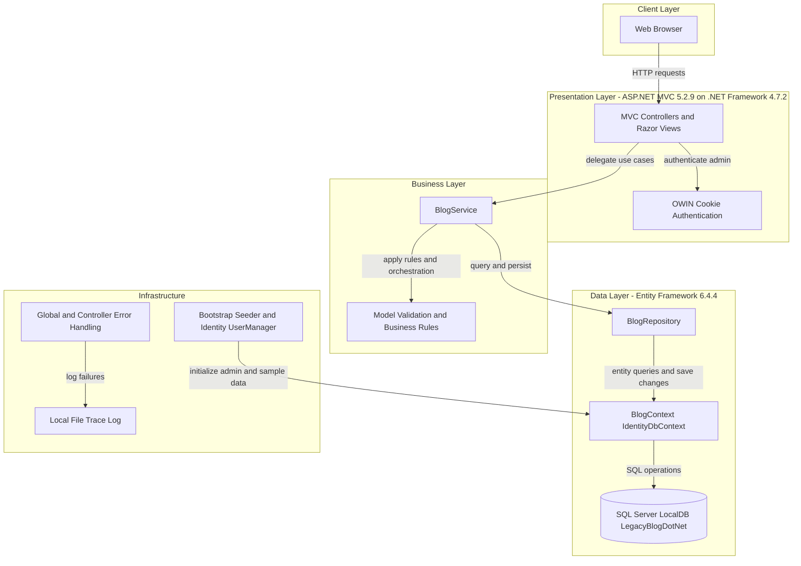
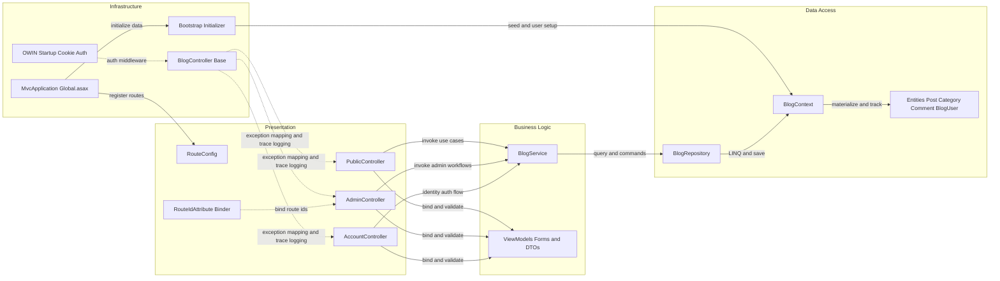

# Architecture Diagram

This document summarizes the current LegacyBlog architecture at two levels: application-level runtime/data flow and key internal component interactions. It reflects the existing ASP.NET MVC 5 monolith implementation.

## Application Architecture

### Technology Stack Summary

| Layer | Technology | Version | Purpose |
|---|---|---|---|
| Presentation | ASP.NET MVC | 5.2.9 | Route handling, controllers, Razor view rendering |
| Presentation | OWIN Cookie Auth | 4.2.2 | Session authentication for admin access |
| Business | Custom service layer (`BlogService`) | N/A | Business rules, validation, orchestration of blog operations |
| Data Access | Entity Framework | 6.4.4 | ORM mapping, querying, persistence |
| Data Access | ASP.NET Identity EntityFramework | 2.2.4 | User store and identity persistence |
| Data Storage | SQL Server LocalDB | MSSQLLocalDB | Stores blog entities and identity tables |
| Infrastructure | .NET Trace logging | .NET Framework 4.7.2 runtime | Writes operational errors to local log files |

### Data Storage & External Services

The application persists all domain and identity data in a single SQL Server LocalDB database (`LegacyBlogDotNet`) accessed through `BlogContext` (an `IdentityDbContext`). There is no external cache or message broker. Runtime integration outside the process is minimal and mainly consists of local file-based tracing for logs and environment-variable based bootstrap/connection configuration.

### Key Architectural Decisions

- Uses a layered monolith pattern where MVC controllers delegate business operations to `BlogService`, which in turn uses a repository abstraction over EF6.
- Centralizes data access with `BlogRepository` and `BlogContext` to keep controllers free of direct persistence concerns.
- Applies cross-cutting error handling in a shared `BlogController` base class and `Global.asax` lifecycle hooks for consistent HTTP error responses and trace logging.

## Component Relationships

### Component Inventory

| Component | Layer | Type | Responsibility |
|---|---|---|---|
| PublicController | Presentation | MVC Controller | Handles public post listing, detail pages, and comment submission |
| AdminController | Presentation | MVC Controller | Handles protected CRUD and moderation workflows for posts, categories, and comments |
| AccountController | Presentation | MVC Controller | Handles login/logout and authentication cookie issuance |
| RouteConfig | Presentation | Route Configuration | Registers attribute routing for MVC endpoints |
| RouteIdAttribute | Presentation | Custom Model Binder | Converts route parameters to integer IDs safely |
| BlogController | Infrastructure | Base Controller | Provides shared `BlogContext`, service wiring, and centralized exception-to-response handling |
| Startup | Infrastructure | OWIN Startup | Configures cookie authentication middleware and auth settings |
| MvcApplication (`Global.asax`) | Infrastructure | Application Bootstrap | Initializes routes, database, seed flow, antiforgery, and trace listeners |
| Bootstrap | Infrastructure | Initializer | Seeds admin user and sample domain data on first startup |
| BlogService | Business Logic | Service | Enforces business rules and orchestrates repository operations |
| BlogRepository | Data Access | Repository | Exposes EF-backed queryables and persistence operations |
| BlogContext | Data Access | DbContext | EF6/Identity context managing entity sets and database interaction |
| Domain Entities | Data Access | Entity Models | Defines persisted data structures for posts, categories, comments, users, and seed state |
| ViewModels (`PostForm`, `CategoryForm`, `CommentForm`, `LoginForm`) | Business Logic | DTO and Validation Models | Captures request input and validation constraints for MVC actions |
