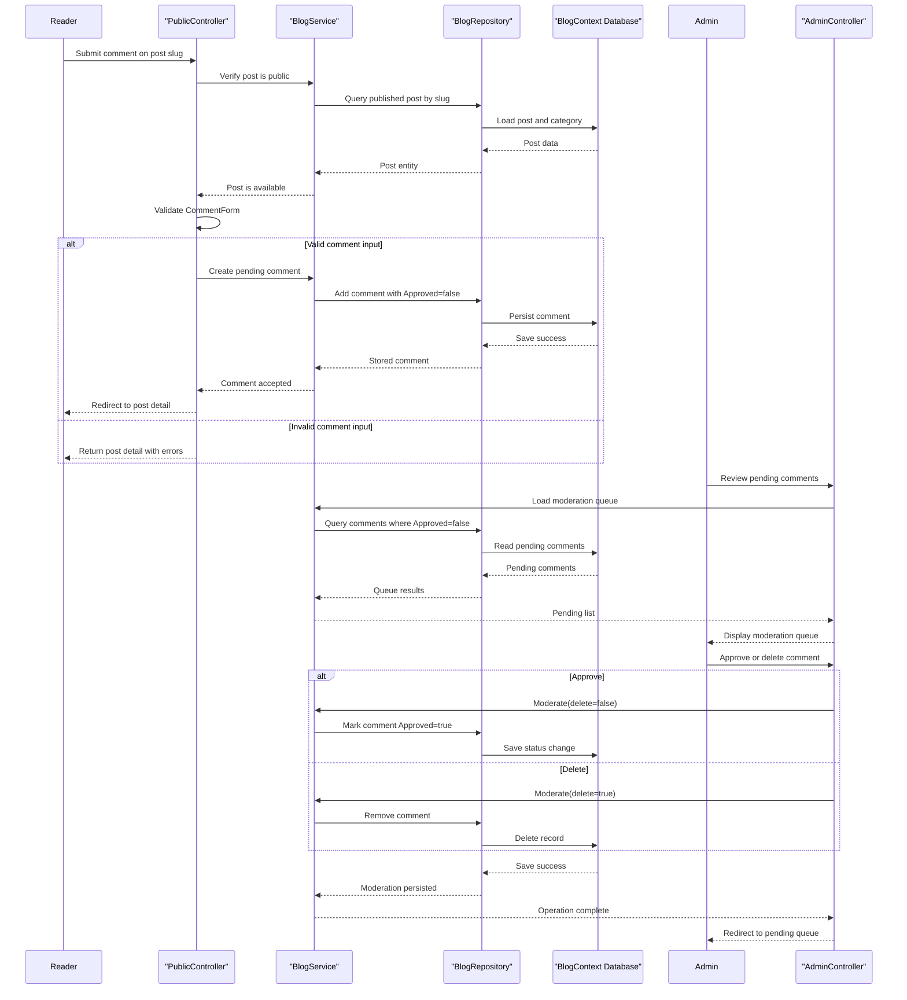

# Core Business Workflows

LegacyBlog is a publishing and moderation application where administrators manage categories, posts, and comment approvals while public readers browse published content and submit comments. It combines editorial workflows, audience interaction, and controlled content publication in a single business domain.

## Domain Entities

| Entity | Service / Bounded Context | Description | Key Relationships |
| --- | --- | --- | --- |
| BlogUser | Identity and Access | Administrator identity used to authenticate into protected editorial workflows. | Grants access to admin-only content management and moderation workflows. |
| Category | Content Taxonomy | Editorial grouping used to classify posts for public browsing and filtering. | One category is associated with many posts; category usage constrains deletion. |
| Post | Publishing | Core content item that moves between draft and published states. | Belongs to a category; has many comments; publication status determines public visibility. |
| Comment | Community Interaction | Reader-submitted feedback attached to a post and subject to moderation. | Belongs to one post; participates in approval or deletion moderation decisions. |
| SeedState | Platform Initialization | Marker for one-time sample data initialization and idempotent bootstrap. | Controls whether initial categories, posts, and comments are created again. |

## Service-to-Domain Mapping

| Service | Domain Context | Owned Entities | External Dependencies |
| --- | --- | --- | --- |
| PublicController + BlogService | Public Reading and Participation | Post (published subset), Category (for browsing), Comment (approved subset and submissions) | BlogRepository/BlogContext persistence layer. |
| AdminController + BlogService | Editorial Management and Moderation | Post, Category, Comment (pending moderation queue) | BlogRepository/BlogContext persistence layer; authenticated admin session. |
| AccountController + Bootstrap.UserManager | Identity and Session Access | BlogUser | ASP.NET Identity user store; OWIN cookie authentication. |
| MvcApplication + Bootstrap.Initialize | Startup and Initial Business State | BlogUser, Category, Post, Comment, SeedState | Environment-provided admin credentials; transactional DB initialization. |
| BlogRepository + BlogContext | Domain Persistence | Post, Category, Comment, BlogUser, SeedState | Entity Framework context and database. |

This project is a layered monolith rather than a distributed microservice architecture: bounded contexts exchange data through in-process service/repository calls and shared transactional storage.

## Primary Workflows

### Workflow 1: Public reader views and comments on a published post

Entry points: `GET /`, `GET /categories/{slug}`, `GET /posts/{slug}`, `POST /posts/{slug}/comments`.

1. Public reader requests the post list or a post detail page.
2. `BlogService.List` validates page input, resolves optional category filter, and returns only published posts for public routes.
3. For post detail, `BlogService.PublicPost` enforces visibility by requiring `Published = true`; unpublished or missing posts are rejected.
4. `BlogService.ApprovedComments` includes only approved comments in the public view.
5. When submitting a comment, `CommentForm` validation gates the operation; invalid input returns to the detail view with validation errors.
6. On valid input, `BlogService.Comment` creates a new comment as pending approval (`Approved = false`) and persists it.

Business rules involved: published-only visibility, positive numeric paging, category existence, form validation, moderation-before-public-display.

### Workflow 2: Administrator creates, edits, publishes, and deletes posts

Entry points: `GET /admin/posts`, `GET/POST /admin/posts/create`, `GET/POST /admin/posts/{id}/edit`, `POST /admin/posts/{id}/publish`, `POST /admin/posts/{id}/unpublish`, `GET/POST /admin/posts/{id}/delete`.

1. Authenticated admin opens the posts management view.
2. On create/edit submit, controller and form validation enforce required post shape (`PostForm`) and valid category selection.
3. `BlogService.SavePost` checks slug uniqueness (`PostSlugTaken`) and either creates a new draft or updates an existing post.
4. Publication actions toggle publish state via `BlogService.Publish`, which sets or clears publication timestamp and updates modification time.
5. Delete action removes the selected post; associated comments are removed through relationship behavior in persistence.

Business rules involved: unique slugs, category existence, draft vs published state transition, timestamp updates on state mutation.

### Workflow 3: Administrator manages categories and moderates reader comments

Entry points: `GET /admin/categories`, `GET/POST /admin/categories/create`, `GET/POST /admin/categories/{id}/edit`, `POST /admin/categories/{id}/delete`, `GET /admin/comments`, `POST /admin/comments/{id}/approve`, `POST /admin/comments/{id}/delete`.

1. Admin manages category records through create/edit forms.
2. `BlogService.SaveCategory` enforces unique category slugs before persistence.
3. Category deletion checks usage (`CategoryInUse`); categories linked to posts cannot be removed.
4. Admin opens pending comments queue.
5. Each comment is either approved (visible publicly) or deleted (removed permanently) via `BlogService.Moderate`.

Business rules involved: unique category slug, category-delete guard when referenced by posts, moderation decision (approve vs delete).

### Workflow 4: First-start bootstrap initializes admin and sample business data

Entry point: application startup in `Application_Start` invoking `Bootstrap.Initialize`.

1. Startup initializes the database and begins a transaction for bootstrap actions.
2. If no users exist, bootstrap requires valid `BLOG_ADMIN_USER` and `BLOG_ADMIN_PASSWORD` values and creates the administrator account.
3. If seed marker `sample-v1` is absent, system creates sample categories, published posts, draft posts, and initial approved/pending comments.
4. Bootstrap stores seed marker and commits transaction to ensure idempotent initialization.

Business rules involved: admin credential format and password length constraints, one-time seed marker guard, transactional initialization consistency.

## Cross-Service Data Flows

The solution uses in-process composition across bounded contexts instead of networked service calls. Public and admin workflows pass through controller entry points into `BlogService`, which composes data from posts, categories, and comments using `BlogRepository` and returns business views (for example, post detail plus approved comments, or post lists filtered by category and publication state).

Identity and content contexts intersect during admin workflows: `AccountController` issues an authenticated session for a `BlogUser`, and `[Authorize(Roles = "Admin")]` gates editorial and moderation workflows before content mutations are allowed.

Business degradation behavior is handled as rejection paths instead of circuit-breaker fallbacks: invalid or conflicting operations produce business-safe outcomes (e.g., invalid form redisplay, 404 for missing/private content, 409 for uniqueness or referential conflicts) rather than partial cross-service responses.

## Business Workflow Sequence

## Business Rules & Decision Logic

1. **Validation rules**
   - `PostForm`: title required, slug required with lowercase-hyphen pattern, body required, category required and positive.
   - `CategoryForm`: name required, slug required with lowercase-hyphen pattern.
   - `CommentForm`: author and body required with length limits.
   - `LoginForm`: username and password required with length constraints.
   - Pagination input must be a positive integer and within range (`BlogService.List`).
2. **Decision logic**
   - Public visibility decision: only posts marked published are accessible on public routes.
   - Moderation decision: comment is either approved (retained and made public) or deleted.
   - Category deletion decision: blocked when any post references that category.
3. **State transitions**
   - Post lifecycle: draft (`Published=false`) to published (`Published=true`, `PublishedAt` set), and published back to draft (`PublishedAt` cleared).
   - Comment lifecycle: pending (`Approved=false`) to approved (`Approved=true`) or deleted.
4. **Business constraints**
   - Post slug and category slug must be unique.
   - Post creation/update requires an existing category.
   - First startup requires valid admin bootstrap credentials; initialization fails fast when invalid.
   - Seed data executes once based on `SeedState` marker.
5. **Computed and integrity behavior**
   - Post list ordering and paging are computed from publication date and page size.
   - Publication and update timestamps are maintained during post mutations.
   - Referential integrity rules enforce category-post and post-comment relationships; deletion outcomes align with these relationships.
6. **Transactions, errors, authorization**
   - Bootstrap initialization runs in one transaction to keep startup state consistent.
   - Business rejections surface as HTTP 400/404/409 style outcomes via controller exception handling.
   - Admin workflows require authenticated role-based access (`Admin` role claim).
