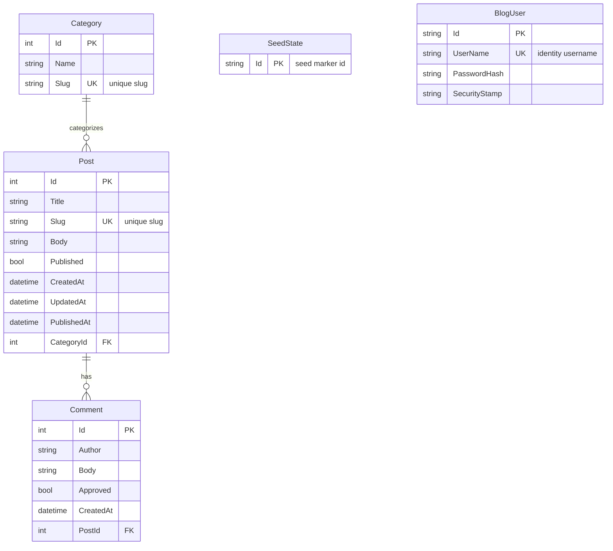

# Data Architecture & Persistence Layer

The data layer is implemented with Entity Framework 6 (`IdentityDbContext<BlogUser>`) over SQL Server, with a small domain model centered on `Category`, `Post`, `Comment`, and seed/identity tables. Persistence is code-first with an explicit create-if-missing initializer and startup seed routine.

## Database Configuration

| Service/Module | DB Type | Profile | Driver | Connection | Migration Tool |
|---|---|---|---|---|---|
| LegacyBlog (ASP.NET MVC monolith) | SQL Server (LocalDB by default) | Default/runtime local profile | `System.Data.SqlClient` via EF6 SQL Server provider | Named connection (`Blog`) in `LegacyBlog\Web.config`; `BlogContext` can override with `BLOG_DOTNET_CONNECTION_STRING` env var for per-environment DB targeting | No active migration framework configured. Schema is created with EF6 `CreateDatabaseIfNotExists`; seed data is applied in `Bootstrap.Initialize` with `SeedState` marker `sample-v1`. |

## Data Ownership per Service

| Service | Tables Owned | ORM Framework | Caching | Notes |
|---|---|---|---|---|
| LegacyBlog (single web app) | `Categories`, `Posts`, `Comments`, `SeedStates`, ASP.NET Identity tables (`AspNetUsers`, `AspNetRoles`, `AspNetUserClaims`, `AspNetUserLogins`, `AspNetUserRoles`) | Entity Framework 6 (`DbContext` + `IdentityDbContext`) | None detected | Single shared database for domain and identity data; no schema-per-module split. |

## Entity Model

## Key Repository Methods

| Service | Repository | Notable Methods | Purpose |
|---|---|---|---|
| LegacyBlog | `BlogRepository` (`LegacyBlog\Repositories\BlogRepository.cs`) | `IQueryable<Post> Posts` (`Include(p => p.Category)`), `IQueryable<Comment> Comments` (`Include(c => c.Post)`), `IQueryable<Category> Categories` | Exposes composable query roots with eager loading for related entities to avoid per-row lazy lookups in service-layer queries. |
| LegacyBlog | `BlogRepository` (`LegacyBlog\Repositories\BlogRepository.cs`) | `Add(Post/Category/Comment)`, `Remove(Post/Category/Comment)`, `Save()` | Write orchestration and unit-of-work commit boundary for CRUD operations. |

## Caching Strategy

No explicit caching provider or cache abstraction is configured. No `MemoryCache`, distributed cache, Redis, EF second-level cache, or cache annotations were found. Data access follows direct EF query execution (cache-aside/read-through patterns are not implemented).

## Data Ownership Boundaries

The application uses a **shared single database** pattern inside one deployable monolith. Domain tables and ASP.NET Identity tables are managed by the same EF context family (`BlogContext`/`IdentityDbContext`) and connection target. Cross-module access is in-process through repository queryables (not cross-service API/database federation). Read/write behavior is traditional CRUD with the same model for reads and writes (no CQRS split).

### Data Classification & Sensitivity

| Entity | Sensitive Fields | Classification (PII/PHI/PCI/None) | Controls in Place |
|---|---|---|---|
| `BlogUser` | `UserName`, `PasswordHash` | PII | Passwords are stored as hashes by ASP.NET Identity; no field-level masking/encryption settings declared in this project. |
| `Comment` | `Author` | PII | No masking or field-level access controls found. |
| `Post` | `Title`, `Body` | None | No special controls required for content fields. |
| `Category` | `Name`, `Slug` | None | No special controls required for taxonomy fields. |
| `SeedState` | `Id` | None | Technical seed marker only. |

