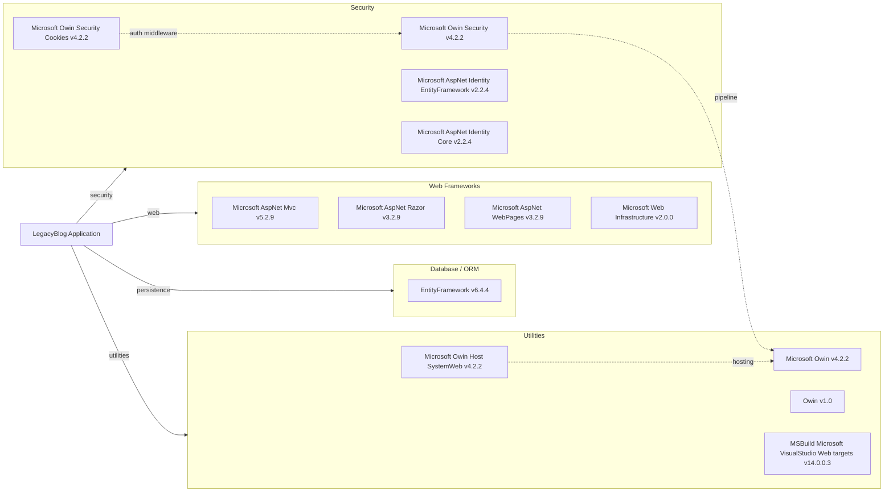

# Dependency Map

This map covers the LegacyBlog .NET project and its declared external dependencies from `packages.config` and `LegacyBlog.csproj`. A total of 13 declared packages were detected (12 runtime/application dependencies and 1 build-time dependency).

## Dependencies

### Dependency Summary

| Category | Count | Key Libraries | Notes |
|---|---:|---|---|
| Web Frameworks | 4 | Microsoft AspNet Mvc 5.2.9, Microsoft AspNet Razor 3.2.9 | Classic ASP.NET MVC 5 stack on .NET Framework |
| Database / ORM | 1 | EntityFramework 6.4.4 | EF6 with SQL Server provider configuration |
| Security | 4 | Microsoft AspNet Identity Core 2.2.4, Microsoft Owin Security 4.2.2 | Cookie auth and identity built on OWIN middleware |
| Utilities | 4 | Microsoft Owin 4.2.2, Owin 1.0 | Includes one build-time package for VS web targets |

### Version & Compatibility Risks

The application targets .NET Framework 4.7.2, which is legacy and limits modernization options compared with .NET (Core) 6/8+ runtimes. ASP.NET MVC 5.x, OWIN 4.x, and Entity Framework 6.x are mature but legacy-era technologies; migration to ASP.NET Core and EF Core typically requires authentication pipeline, middleware, and data-access refactoring.

### Notable Observations

- No modern observability, logging facade, or distributed tracing packages are declared, suggesting reliance on framework defaults or custom logging.
- The stack mixes `Owin` v1.0 abstraction with `Microsoft.Owin` v4.2.2 middleware components, a common legacy pattern that needs consolidation during migration.
- `MSBuild.Microsoft.VisualStudio.Web.targets` is declared as a development dependency, indicating build coupling to older Visual Studio web targets.
- No messaging or caching libraries are declared, implying a primarily synchronous web-plus-database architecture.

## Test Dependencies

| Framework | Version | Notes |
|---|---|---|
| None detected | N/A | No test-scoped dependencies found in analyzed manifests |

Total test-scope dependencies: 0  
No test dependencies were detected in the project manifests, so test infrastructure appears either absent or located outside this project.
